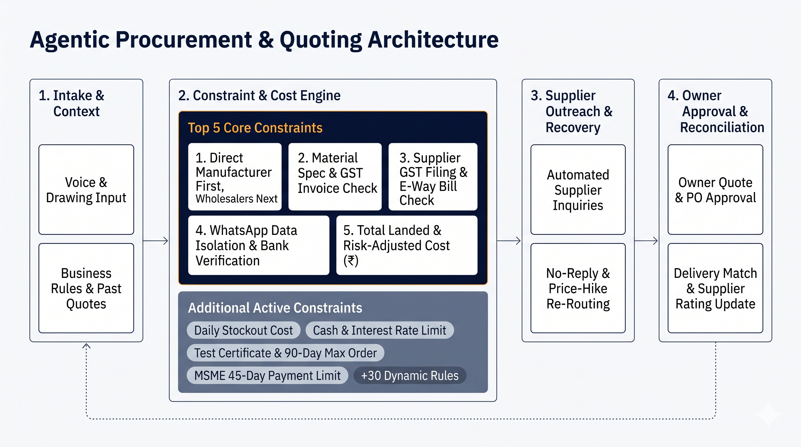

# Agentic Procurement & Quoting Co-Pilot for Small Manufacturers

**Tech4Bharat 2026 — JanAI Mass Entrepreneurship Challenge | Theme 4: Manufacturing & Industry | Problem 4.1**

> **Pitch Deck:** [`docs/presentation.pdf`](docs/presentation.pdf)
> **Architecture Diagram:** [`docs/flowchart.png`](docs/flowchart.png)

---

## 1. The Problem We Are Solving

Small factories (5–50 workers) in sheet-metal fabrication, plastics, garments, and components carry India's manufacturing jobs — yet their buying and quoting still runs on panicked phone calls, messy WhatsApp chats, and rough guesswork:

- **Overpaying for Raw Material:** When stock runs out, owners call 5–10 suppliers and pick the fastest reply or lowest sticker rate — missing hidden transport charges, unloading (*hamali*), credit costs, and GST Input Tax Credit (ITC) losses.
- **Quoting Customer Orders at a Loss:** Rough drawings and vague buyer requests are priced using thumb rules rather than exact material yield and scrap waste — leading to underpriced loss-making jobs or lost bids.
- **Limited Customer Reach:** Slow, manual quoting keeps small units dependent on a few familiar local buyers.

---

## 2. Grounded in Real Field Research

Before designing anything, we interviewed a **wholesale and retail distributor in Magadi town, Karnataka (~20 years of trade experience)** alongside local fabrication shop-floor operators. Three market realities directly shape every rule in our system:

1. **The "With-Bill vs. Without-Bill" Trap:** Suppliers quote dual rates. While cash/unbilled rates work for end-consumer (B2C) retail, GST-registered (B2B) factories that buy unbilled lose **18% Input Tax Credit (ITC)**, forfeit income-tax deductions, and cannot generate valid **E-Way bills** on consignments above ₹50,000.
2. **Transport & *Hamali* Distortion:** *Ex-Godown* rates cover material only at the supplier's door — the buyer pays separately for tempo hire and unloading labour (*hamali*). Owners comparing raw per-kg numbers on WhatsApp routinely miss this.
3. **Direct Mills vs. Local Wholesalers:** Direct manufacturers offer lower base rates and Mill Test Certificates (MTCs) on larger order quantities. Local wholesalers rescue urgent jobs with smaller quantities and faster same-day delivery.

Full anonymized field notes → [`field-research/magadi_distributor_faq.md`](field-research/magadi_distributor_faq.md) · Sample RFQs & Quote Comparisons → [`field-research/examples.md`](field-research/examples.md)

---

## 3. How It Works — 4-Stage Workflow



```
Owner Voice/Drawing
       │
       ▼
┌──────────────────┐    ┌──────────────────────┐    ┌────────────────────┐    ┌─────────────────────┐
│  STAGE 1         │    │  STAGE 2             │    │  STAGE 3           │    │  STAGE 4            │
│  INTAKE AGENT    │───▶│  SOURCING AGENT      │───▶│  COST ENGINE       │───▶│  APPROVAL & CLOSE   │
│  (LangGraph)     │    │  (LangGraph)         │    │  (Pure Python)     │    │  (LangGraph HITL)   │
│                  │    │                      │    │                    │    │                     │
│ • Parses voice + │    │ • Wave 1: Preferred  │    │ • 35+ deterministic│    │ • ≤₹5k auto-approve │
│   drawings into  │    │   direct mill        │    │   ₹ rules          │    │ • ≤₹50k one-tap     │
│   structured     │    │ • Wave 2: Rival mills│    │ • Full landed cost │    │ • >₹50k Voice+PIN   │
│   order schema   │    │ • Wave 3: Local      │    │   formula          │    │ • 3-way PO/challan/ │
│ • Checks stock,  │    │   wholesaler (last   │    │ • GSTIN/GSTR-3B    │    │   invoice match     │
│   open POs,      │    │   resort only)       │    │   verification     │    │ • Owner releases    │
│   substitutes    │    │ • Auto failure       │    │ • E-Way + MSME     │    │   all payments      │
│ • Restates specs │    │   recovery           │    │   45-day checks    │    │                     │
│   before any     │    │                      │    │ • WhatsApp sandbox │    │                     │
│   supplier       │    │                      │    │   (prompt-inject   │    │                     │
│   contact        │    │                      │    │   blocked)         │    │                     │
└──────────────────┘    └──────────────────────┘    └────────────────────┘    └─────────────────────┘
```

### Stage 1 — Intake Agent
Parses voice notes (Kannada / Hindi / English) or customer drawings into a structured order schema. Checks existing stock, open POs, in-transit stock, and approved substitutes. Restates parsed specs to the owner **before contacting any supplier.**

### Stage 2 — Sourcing Agent (3-Wave Waterfall)
- **Wave 1:** Preferred direct manufacturer — lowest rate + Mill Test Certificate.
- **Wave 2:** Rival direct mills — benchmark pricing.
- **Wave 3:** Local wholesalers — **only** if mill MOQ too large or ETA missed.
- **Automatic Recovery:** Supplier times out or hikes price mid-quote? Agent switches to next-best — zero manual follow-up.

### Stage 3 — Cost Engine (Deterministic Python)

```
Risk-Adjusted Cost (₹) =
    C_landed     (unit price × qty + freight + hamali + packaging − cash discount)
  + C_itc_loss   (GST amount, only if buyer cannot claim ITC)
  + C_capital    (financing cost: advance payment vs. credit days at owner's APR)
  + C_defect     (P(defect) × expected cost of bad lot, from supplier history)
  + C_stockout   (₹/day × max(0, delivery days − days of stock remaining))
  + C_holding    (excess MOQ units × unit cost × APR/365 × extra days held)
```

**35+ built-in constraint checks include:**
- GSTIN validity and GSTR-3B filing status (last 2 consecutive months)
- E-Way bill eligibility (₹50,000 threshold, Karnataka + inter-state)
- 45-day MSME payment deadline (Section 37(2)(g), Income-tax Act 2025 — effective 1 April 2026)
- ITC 180-day reversal rule
- 90-day MOQ cap (safe demand ceiling)
- Margin floor enforcement on customer quotes
- Cash/OD headroom check
- WhatsApp prompt-injection sandbox

### Stage 4 — Approval & Close (Human-in-the-Loop)

| Spend Level | Action |
|---|---|
| ≤ ₹5,000 (repeat SKU + verified vendor) | Auto-approved |
| ≤ ₹50,000 | One-tap approval |
| > ₹50,000 | Voice + PIN confirmation |

Post-delivery: 3-way match (PO / challan / invoice), 24–48 hr damage alert, GSTR-2B recon, supplier rating updated.

---

## 4. Safety & Control Boundaries

| Boundary | Detail |
|---|---|
| **Zero Auto-Payment** | AI **never** initiates or releases any payment. The buyer approves and pays directly. |
| **WhatsApp Protection** | Supplier chat treated as untrusted input. No message overrides agent rules or changes bank/UPI details without a freeze. |
| **Spend-Authority Tiers** | Auto ≤ ₹5k · One-tap ≤ ₹50k · Voice+PIN > ₹50k |
| **[SIMULATED] Disclosure** | All supplier WhatsApp, GST portal, and GSTN API calls run on clearly labelled `[SIMULATED]` demo mocks per Tech4Bharat Agentic AI guidelines. |
| **Data Minimization** | Only data necessary for the purchase decision is stored. No personal supplier contact details shared outside the agent's sandboxed context. |
| **Explicit Consent** | Owner consent collected before any supplier outreach. Owner can halt the process at any stage. |

---

## 5. Tech Stack

| Layer | Technology | Why |
|---|---|---|
| Agent Orchestration | **LangGraph** | Native human-in-the-loop interrupt nodes, persistent state, failure recovery |
| Cost & Rules Engine | **Pure Python + Pydantic** | Deterministic — zero LLM hallucination risk on rupee calculations |
| LLM (Intake/NLU) | **Gemini Flash / Groq Llama-3.3-70B** (free tier) | Multilingual voice + document parsing |
| Backend API | **FastAPI** | Lightweight, async |
| Database | **SQLite / PostgreSQL** | Supplier master, SKU profiles, order history |
| Frontend | **React PWA (mobile-first)** | Entry-level Android, offline-capable, vernacular UI |
| Simulated APIs | Mock WhatsApp, GSTN, E-Way | Labelled `[SIMULATED]` per competition guidelines |
| Total Cost | **₹0** | All free-tier / open-source |

---

## 6. Repository Structure

```
tech4bharat-procurement-copilot/
├── README.md
├── docs/
│   ├── flowchart.png
│   └── presentation.pdf
└── field-research/
    ├── examples.md
    └── magadi_distributor_faq.md
```

> Source code (`src/`), backtests (`backtest/`), and simulated integrations will be added as the build progresses. This repository is the Phase 1 research, design, and architecture submission.

---

## 7. Competition Context

| Field | Value |
|---|---|
| Hackathon | Tech4Bharat 2026 — JanAI Mass Entrepreneurship Challenge |
| Organizers | GAVS / HackCulture / RVCE / KAVMS |
| Track | Theme 4: Manufacturing & Industry |
| Problem | 4.1 — Small factories overpay for raw material and quote orders at a loss |
| AI Bar | Agentic AI: multi-step goal · external system actions · case memory · failure recovery · human-in-the-loop |
| Operating Conditions | Voice-first & vernacular · Entry-level Android PWA · JanAI Café assisted-path · Explicit consent & data minimization |

---

*Phase 1 submission — field research, architecture, and design. Source code implementation in progress.*
